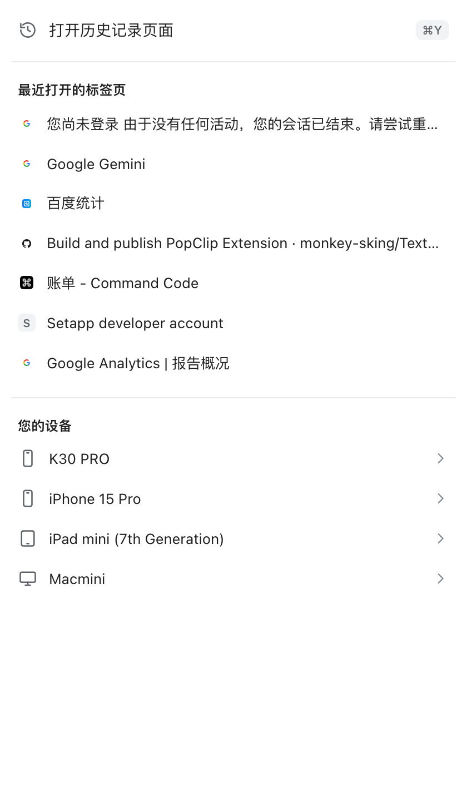
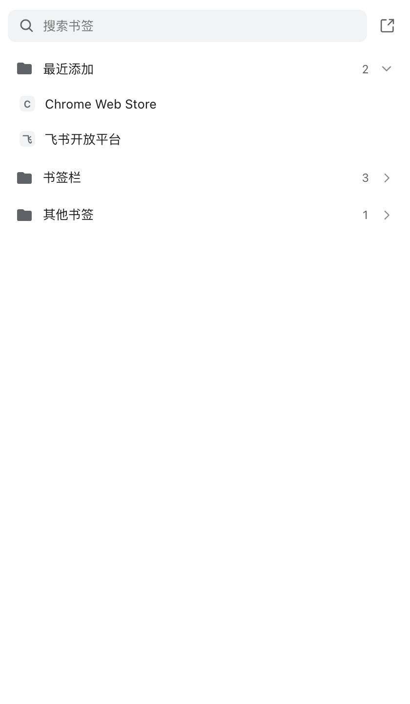

# 书签 / 历史 快捷面板

Chrome 工具栏上的一个小按钮：**左键打开书签面板，右键菜单里选「历史记录面板」**，弹出和 Chrome 自带「历史记录」下拉同结构的面板（打开历史记录页面 / 最近打开的标签页 / 您的设备）。





## 为什么是复刻面板

Chrome 没有向扩展开放「打开自带历史记录下拉面板」的 API —— 那个面板属于浏览器界面，不是网页，扩展无法调用。所以这里用官方 API 复刻了同样的信息结构：

| 面板内容 | 数据来源 |
| --- | --- |
| 最近打开的标签页 | `chrome.tabs.query()`，按 `lastAccessed` 排序并按 URL 去重 |
| 您的设备 | `chrome.sessions.getDevices()`（需登录 Chrome 并开启同步） |
| 打开历史记录页面 | `chrome://history/` |
| 书签 / 搜索 / 最近添加 | `chrome.bookmarks` |

## 功能

- **左键 → 书签面板**
  - 顶部实时搜索书签
  - 「最近添加」默认展开，书签栏 / 其他书签可折叠，支持嵌套文件夹
  - 右上角图标直达书签管理器
  - 点击书签在新标签页打开
- **右键 → 扩展菜单**
  - 历史记录面板（贴在按钮下方弹出）
  - 书签面板
  - 打开历史记录页面
  - 打开书签管理器
- 浅色 / 深色主题自动跟随系统
- `Esc` 关闭面板

> 说明：右键点击工具栏图标时，Chrome 一定会先弹出它自己的扩展菜单，所以「右键 → 历史」实际是两下（右键，再点「历史记录面板」）。这是浏览器行为，扩展无法绕过。

## 安装（加载已解压）

1. 打开 `chrome://extensions`
2. 右上角打开 **开发者模式**
3. 点 **加载已解压的扩展程序**，选择本仓库目录
4. 点工具栏的扩展拼图图标，把「书签 / 历史 快捷面板」**固定**到工具栏

## 开发

```bash
git clone https://github.com/monkey-sking/chrome-quick-panel.git
cd chrome-quick-panel
```

修改后在 `chrome://extensions` 里点扩展卡片上的刷新按钮即可生效。

重新生成图标（需要 Pillow）：

```bash
python3 tools/make_icons.py
```

打包上架用的 ZIP（自动去掉 `key` 字段，`dist/` 已加入 .gitignore）：

```bash
bash scripts/package.sh
```

## 权限说明

| 权限 | 用途 |
| --- | --- |
| `tabs` | 读取标签页标题、地址、最近访问时间，用于「最近打开的标签页」 |
| `sessions` | 读取同步设备列表，用于「您的设备」 |
| `bookmarks` | 读取和搜索书签 |
| `contextMenus` | 工具栏图标的右键菜单 |
| `favicon` | 用 Chrome 本地缓存渲染网站图标，不联网 |

没有申请任何 host 权限，不注入页面，不读取网页内容，不发送任何数据。详见 [PRIVACY.md](PRIVACY.md)。

## 已知限制

- 「您的设备」依赖 Chrome 账号同步，未登录时显示空状态。
- 历史面板展示本机最近访问的标签页（最多 10 条），不是跨设备历史全文；跨设备历史请用 `chrome://history/`。
- 右键菜单里的「历史记录面板」在 Chrome 127+ 会贴在按钮下方弹出，更低版本自动退化为独立小窗口。

## English

A tiny Chrome toolbar button: left-click opens a bookmarks panel, right-click menu opens a history panel that mirrors Chrome's built-in history dropdown (open history page / recently opened tabs / your devices). Chrome does not expose an API for the native history dropdown, so this is a faithful re-implementation using `chrome.tabs`, `chrome.sessions`, and `chrome.bookmarks`. No host permissions, no page injection, no data collection.

## License

[MIT](LICENSE)
